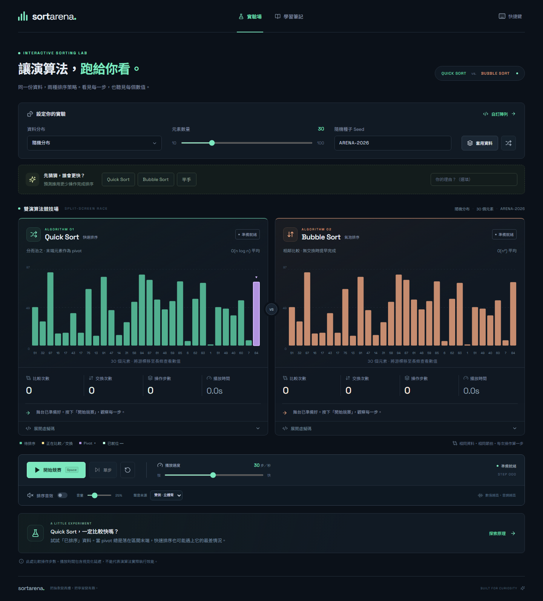
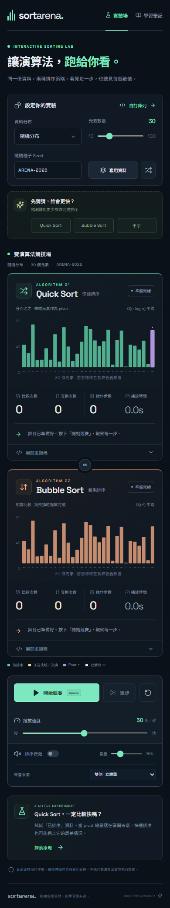

# Sort Arena

互動式排序演算法實驗場，依照同資料夾的規劃書實作。以 React、TypeScript、Vite、SVG 和 Web Audio API 製作，無須後端或帳號。

## 本機啟動

需要 Node.js 20.19+ 或 22.12+（建議使用目前的 LTS 版本）。從 GitHub 下載後，在 PowerShell 執行：

```powershell
git clone https://github.com/asaxin777/sort-arena.git
cd sort-arena
npm.cmd ci
npm.cmd run dev
```

若已經在原本的 `midterm` 資料夾中，可以直接執行 `npm.cmd run dev`。開啟終端機顯示的網址，預設為 http://127.0.0.1:5173。使用完畢後，在執行伺服器的終端機按 `Ctrl+C` 即可停止；只關閉瀏覽器分頁不會停止伺服器。

這個專案使用開發伺服器提供模組，請勿直接以檔案總管開啟 `index.html`。

PowerShell 若限制執行 `.ps1`，使用上面的 `npm.cmd` 即可，不需要修改執行原則。在其他 shell 可以直接使用 `npm`。

## 畫面預覽



<details>
<summary>查看手機版</summary>



</details>

## 操作方式

1. 選擇資料分布、元素數量與 seed，按「套用資料」；同樣設定能重現相同輸入。「隨機換一組資料」會替換 seed。
2. 「自訂陣列」接受 2～100 個介於 1～100 的整數，以半形或全形逗號分隔。
3. 可先預測 Quick Sort、Bubble Sort 或平手，再開始競賽。兩側使用初始資料的獨立副本，共用一個播放時鐘。
4. 執行中可暫停與調整每秒 1～60 步；暫停時可單步。重設會保留原始陣列並清除統計。
5. 音效預設關閉，點擊開啟後才會使用 Web Audio API。可調音量並選擇單側或雙側立體聲；暫停、重設及切換來源會停止目前音符。
6. 展開兩側虛擬碼，可搭配步驟字幕理解比較、交換、pivot 和已就位區域。
7. 競賽結束後，可拖曳時間軸靜音回看；結果區與 JSON 匯出保留原始比賽統計。JSON 包含初始陣列、seed、演算法版本與結果，可用於報告或重現實驗。
8. 手機版兩側上下排列；播放控制不在可視範圍時，競賽中會出現精簡浮動控制列。

快捷鍵：空白鍵開始／暫停／繼續，右方向鍵在暫停時單步。當焦點在輸入欄位、滑桿或選單上，保留該控制項的鍵盤行為；按鈕上的空白鍵會啟動該按鈕。也可以使用 Tab 逐一操作控制項。介面支援系統的減少動態設定。

## 計數與競賽規則

- Quick Sort 使用末端 pivot 的 Lomuto partition；Bubble Sort 在整輪沒有交換時提早完成。
- 只有元素大小比較列入「比較次數」，不計迴圈判斷。
- 只有不同索引的交換列入「交換次數」；值相同但索引不同的實際交換仍然計算。
- 操作步數＝比較次數＋交換次數。pivot、區間與就位標記隨操作更新，不額外耗用節拍。
- 每個節拍，每側最多前進一個操作。先完成者保留畫面，另一側繼續。
- 勝負以最終操作步數判斷，允許平手。播放時間包含視覺化延遲並排除暫停，不能當作演算法實際效能測試；全程手動單步時，播放時間可以為零。
- 拖曳回放時，面板顯示原比賽完成時間；比較、交換與陣列呈現所選步驟的狀態。

建議先用 `3, 2, 1` 慢速展示：Bubble Sort 最終應有 3 次比較與 3 次交換。再選「已排序」觀察 Bubble Sort 的提早結束，以及固定末端 pivot 的 Quick Sort 退化。

## 專案結構

```text
src/
  App.tsx           競賽介面、共同播放時鐘與結果
  engine.ts         排序 generators、資料生成、輸入驗證
  engine.test.ts    排序正確性與事件計數測試
  player.ts         單步狀態與回放重建
  player.test.ts    播放、不可變狀態、回放測試
  audio.ts          可選的音效、節流與音符生命週期
  styles.css        桌面／手機版面與減少動態設定
e2e/arena.spec.ts    Chromium 瀏覽器流程測試
```

## 建置與驗證

```powershell
npm.cmd test
npm.cmd run build
npm.cmd run test:e2e
```

第一次在其他電腦執行瀏覽器測試，若未安裝 Playwright Chromium：

```powershell
npx.cmd playwright install chromium
```

E2E 測試會自行啟動本機伺服器。正式靜態輸出位於 `dist/`，可用 `npm.cmd run preview` 查看建置結果。需要部署到子路徑時，請在 `vite.config.ts` 設定相應的 `base`。

字型使用 Google Fonts，網路無法載入時會退回系統字型；排序、統計與控制邏輯不依賴外部 API。瀏覽器不支援或拒絕音效時，會顯示提示並保留視覺化功能。
